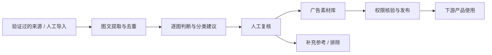

# OmniSignal · Ad Workbench

**OmniSignal 的广告素材工作台变体：收集、筛选和整理品牌广告与促销素材。**

> 阶段：规划中。此分支当前基于原版公开代码，仅新增变体说明与重构方案。新的素材库前端、广告分类和发布流程尚未实现；克隆运行仍会进入原版控制台。

[完整重构方案](docs/omni-ad-workbench-plan-v1.md) · [原版 OmniSignal](https://github.com/LazyS1a/OmniSignal/tree/main) · [原版运行说明](https://github.com/LazyS1a/OmniSignal/blob/main/README.md)

## 这个变体做什么

将 Omni 从通用采集控制台，逐步改造成以图片为中心的广告素材工作台。

| 内容方向 | 典型内容 |
| --- | --- |
| 品牌广告 | 品牌海报、传播活动主视觉、新品发布、户外广告 |
| 促销与转化 | 促销海报、电商活动图、广告横幅、社交广告静态图 |

同一素材可以同时属于两类。包装、摄影、空间等设计案例作为补充参考，不因“有设计感”就自动进入广告主库。

目标主导航只有 **素材库、待处理、采集**。技术诊断和管理员配置集中到设置中。素材浏览保留图片完整比例，详情展示文案、视觉拆解和可追溯出处。

## 分支与实现状态

- `main`：原版 OmniSignal 的公开基线。
- `variant/ad-workbench`：本变体的方案与后续开发分支。
- 本次分支起点：`4033cf776298962556af0c14b16a3820b5efda3b`。

| 能力 | 本分支状态 |
| --- | --- |
| 原版采集、标准化、审计与 FastAPI / Streamlit 基础 | 继承公开基线；运行方式见原版文档 |
| 双内容方向、信息架构、迁移路线与验收标准 | 已形成方案 |
| React / TypeScript 素材工作台 | 待实现 |
| 逐图广告相关性、广告标签与人工复核 | 待实现 / 验收 |
| 广告来源自动采集与持续更新 | 待逐站验证，未承诺任何站点已接通 |
| 素材准备、版本化知识发布、下游同步 | 待迁入审查或实现；本提交未包含 |

原版在线 Demo、历史测试数量和发布徽章不能作为本变体新功能的验证结果。本次改动只做文档检查，未执行运行时代码测试。

## 目标流程



规则负责基础过滤，图文模型提供分类与拆解建议，人工负责复核。未配置模型时允许人工处理；来源事实、图像观察与模型推断分别记录。使用权限不由模型决定。

## 实施顺序

- [ ] **P0 内容标准**：两类各 15 张、非广告 10 张、难判断 10 张的评测样本；定义来源与逐图纳入标准。
- [ ] **P1 交互原型**：素材库、详情、待处理、采集及必要的登录与设置。
- [ ] **P2 内容管线**：逐站验证、素材级分类、去重、人工纠错与失败恢复。
- [ ] **P3 产品实现**：新前端、分页缩略图、持久化操作、采集计划控制、会话权限和发布流程。
- [ ] **P4 迁移验收**：历史数据映射、角色权限、交付回执、备份回退及入口切换。

计划采用 React + TypeScript + Vite 静态构建，复用 FastAPI 后端基础。Streamlit 作为迁移期间的管理入口。具体数据模型、验收标准及来源限制见完整方案。

## 开发约定

开发本变体时检出此分支：

```sh
git clone --branch variant/ad-workbench https://github.com/LazyS1a/OmniSignal.git
cd OmniSignal
```

上述命令只获取分支，不会部署服务或启动采集。原版安装与运行步骤见[主分支 README](https://github.com/LazyS1a/OmniSignal/blob/main/README.md)。新前端完成前不提供虚构启动命令。

通用修复可单独提交回原版；广告界面、标签与评测留在本变体维护。新增能力必须带真实验收结果，再更新本页状态。

真实凭据、内部部署信息、私有业务代码、运行数据及原始采集图片不随本次文档提交公开。测试示例优先使用合成素材；引用第三方图片应保留来源并核对使用范围。

## License

沿用 [MIT License](LICENSE)。第三方依赖、图片和来源内容各自适用其原有授权；源码许可证不授予第三方图片的使用权。
