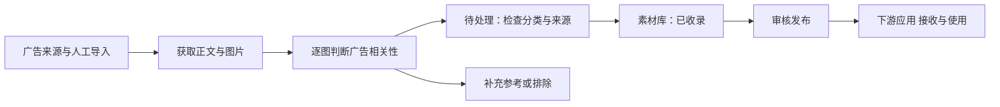

# Omni 广告素材工作台重构方案 v1

日期：2026-10-23。状态：方案已进入实施，首版工作流已完成；当前能力与验收边界以 README 和运行说明为准。

本分支基于 OmniSignal 已公开的 main 基线。首版已实现素材工作台、受权限保护的采集计划、人工审核、可选图文分析与签名交付。下文保留完整目标路线；50张真实标注样本、两类相关性评测、实际模型效果及消费方现场接收仍需独立验收。

变体目标：品牌宣传主视觉与促销、电商、社交投放素材两类都要；全面重做 Omni 前端，减少界面冗杂。内容定位优先满足广告参考需求，泛设计图片作为补充。

## 1. 产品定位

Omni 负责“找到广告素材、判断相关性、整理、审核、交付”；下游应用 负责“在业务场景中使用素材、获得灵感、对话和创作”。Omni 的首屏是一张能直接看图、筛选和处理素材的工作台。

主流程：



“收录”表示符合 Omni 的资料筛选标准，不表示获得了商用、下载或模型分析授权；发布须经过独立的权限核验与审核流程。

### 两类核心内容

| 入口 | 用户要找什么 | 典型内容 | 分类时需要关注 |
| --- | --- | --- | --- |
| 品牌广告 | 品牌形象、创意表达、视觉叙事 | 品牌宣传海报、传播活动主视觉、新品发布广告、户外广告 | 核心创意、品牌识别、画面构成、信息层级 |
| 促销与转化 | 卖点、优惠、引导行动、产品展示 | 促销海报、电商活动图、广告横幅、社交广告静态图 | 产品、卖点、价格/优惠、行动指引、排版与规格 |

这两类是传播目的，可以同时命中。社交平台是发布渠道，不能直接等同于促销；一张 Instagram 品牌海报也可能属于品牌广告。

首版聚焦静态图片与轮播组图，保留视频来源链接；视频下载、抽帧和长视频分析后续独立评估。以海外来源起步，不默认绑定任何单一品牌。

## 2. 为什么现状不适合继续堆功能

根据原版控制台与素材准备流程的使用评估，目标调整如下。表中包含原版体验及独立试验流程，不是本分支功能清单：

| 现状 | 用户感受到的问题 | 重构决策 |
| --- | --- | --- |
| 8 个默认导航入口，另有研究页开关 | 不知道应该点哪里 | 主导航收敛为素材库、待处理、采集 |
| 运行概览是默认首页 | 打开先看到系统信息，看不到素材 | 默认打开素材库 |
| 案例通过下拉框逐个选择 | 很难浏览、对比和找图 | 图片网格＋筛选＋详情抽屉 |
| 页面顶部大量发布协议、凭据和同步状态 | 像技术控制台，解释压过内容 | 技术信息归入管理员设置；只保留可行动的异常提醒 |
| 采集按设计媒体项目筛选 | 抓到包装、店面、书籍也被当作灵感 | 对每张图片判定是否属于广告主素材 |
| 标签主要是包装、编辑出版、空间等设计门类 | 无法按营销目标找素材 | 增加广告目的、形式、渠道、卖点和行动指引 |
| 自动采集后还没有实际模型整理 | 原始图片多，但可理解的信息少 | 建立有证据的分类与中文拆解；未分析明确显示 |

实际可用能力以本分支 README 为准。素材准备、模型分类和下游同步需要独立实现或审核迁入后验收。

## 3. 内容先调整：来源与逐图筛选

### 来源策略

| 来源组 | 用途 | 首版接入策略 | 当前证据与限制 |
| --- | --- | --- | --- |
| 广告项目媒体，例如 Ads of the World | 品牌广告、传播活动 | 第一批做小样本采集验证，区分真实品牌作品与学生/概念作品 | 官方页面可检索到广告项目；Omni 尚未验证其图片抓取、持续获取和使用范围 |
| 品牌官网活动页、品牌/代理商公开广告项目页 | 品牌广告与部分促销 | 按具体站点白名单逐个验证，保留原始出处 | 不能把所有官网图片当广告，也不承诺通用抓全站 |
| Meta Ad Library、Google Ads Transparency Center | 广告来源核验与渠道信息 | 先提供来源链接、人工导入；自动化接入单独验收 | 入口存在不代表可自动获取；自动化访问、图片提取与持续更新均待验证 |
| 用户已有素材、经授权使用的素材 | 两类内容的高确定性起步数据 | 文件/链接导入，填写来源和用途状态 | “用户导入”本身不自动变成“可商用” |
| BP&O、It’s Nice That | 补充设计参考，少量相关广告 | 降为补充来源，只有逐图通过广告筛选的素材进入主库 | 逐站验证页面提取能力，并逐图判断是否适合广告主库 |
| Packaging of the World | 包装参考 | 暂不作为主广告来源，也不列入首批自动采集验收 | 内容方向偏包装，访问与使用范围需要单独验证 |

来源建议依据：[Ads of the World 官方首页](https://www.adsoftheworld.com/)、[Meta 广告库入口](https://www.facebook.com/ads/library/)、[Google Ads Transparency Center](https://adstransparency.google.com/)、[Google 对广告透明度的说明](https://support.google.com/adspolicy/answer/13733850?hl=en)。可浏览、可自动获取、可展示使用是三个分别验证的条件。

### 图片判断流程

1. 规则预筛：过滤头像、站点 Logo、导航图、重复图片、低清图、明显页面装饰；同一项目分组。
2. 图文联合判断：结合图片本身、图片邻近说明和项目背景，判断是广告主视觉、促销素材、补充参考、非广告或无法判断。
3. 提取可见信息：品牌/产品、图片文字、优惠与行动指引、画面形式；不清楚的留空。
4. 输出理由：例如“画面存在产品、活动文案及购买指引”；标明源文事实、图像观察与模型推断。
5. 人工确认：首轮全部经过待处理区；不确定项不能默认进入广告主库。

包装本身不是自动排除条件：如果它出现在完整的产品广告画面中，整张广告可以收录；孤立包装实物照通常作为补充参考。实景户外广告可以保留广告区域和场景上下文，普通门店照片不因此变成广告。

不用“有大字就是广告”“画面好看就是广告”这类单一规则。模型只负责建议分类和整理，不决定使用权限、不替人审核发布。来源内容里的指令作为资料处理，不能改变分析流程。

### 有广告感，不等于确认投放

每张素材另记来源证据：来源明确标注广告项目、来自广告库、概念/学生作品、尚未确认。没有出处证据时不能展示“已投放”，也不能编造点击率、转化率、ROI 或“爆款”评价。

## 4. 前端信息架构

主导航只有三个入口；设置、账号和帮助放右上角。

| 入口 | 核心任务 | 默认内容 | 主要操作 |
| --- | --- | --- | --- |
| 素材库（首页） | 找到值得参考的广告图 | 已收录素材的图片网格 | 搜索、筛选、看详情、加入发布清单 |
| 待处理 | 判断新素材能不能留下 | 待分类/待核对/退回内容 | 收录、改分类、移至补充参考、排除 |
| 采集 | 决定找什么、从哪里找 | 采集计划卡片和最近结果 | 新建计划、暂停/恢复、查看结果和失败原因 |

素材库内二级筛选：“全部广告 / 品牌广告 / 促销与转化”；补充参考在更多筛选中打开，默认不混入广告网格。没有已收录广告时显示诚实的空状态和“查看待处理”，不拿旧包装样本填首页。

### 首页布局草图

```text
┌ Omni  素材库  待处理  采集                         设置 · 账号 ┐
│ 搜索：品牌、产品、文案、活动……                  导入素材     │
│ 全部广告 | 品牌广告 | 促销与转化                            │
│ 行业 ▾  品牌 ▾  形式 ▾  更多筛选 ▾        最近收录 ▾        │
│                                                            │
│   [完整广告图片]   [完整广告图片]   [完整广告图片]            │
│   品牌 · 项目      品牌 · 项目      品牌 · 项目               │
│   分类 / 来源      分类 / 来源      分类 / 来源               │
│                                                            │
│   [完整广告图片]   [完整广告图片]   [完整广告图片]            │
└────────────────────────────────────────────────────────────┘
```

图片占据主要视觉空间。卡片默认只展示图片、品牌/标题、广告分类、出处与必要状态，不把长分析、哈希、模型参数塞进去。采用有留白的网格，完整呈现图片比例；不裁掉广告标题、优惠价格或行动按钮。横版、竖版图分别适配缩略图，不强拉伸。

### 素材详情

点击卡片打开详情抽屉或宽屏详情页，返回后保留筛选条件与滚动位置。

- 左侧：大图、同项目变体、小缩略图和查看原图。
- 右侧第一屏：品牌/项目、两类广告标签、中文概述、来源和当前处理状态。
- “广告拆解”：主信息、卖点、文案、视觉组织、可借鉴点；每条区分事实、观察和推断。
- “来源与用途”：发布日期、采集时间、出处链接、投放证据和用途状态。
- 底部按角色显示：修改分类、收录/退回、加入发布清单。

首版不另做设计师项目板、创作画布、聊天助手或全套收藏系统，避免和下游应用重复；“加入发布清单”用于 Omni 的交付操作。

### 待处理页

采用“左侧待处理缩略图列表＋右侧当前素材大图和判断结果”。可以直接比较同一项目的广告主图、包装照、店面照，逐张决定去留。

常用操作只有“收录”“改分类”“补充参考”“排除”。排除是可恢复的软状态，记录原因，保留溯源。批量操作只对明确选中的素材执行，并展示数量和结果；权限不明确的素材不允许批量发布。

### 采集页

把来源配置、任务和最近运行合并成“采集计划”：看什么品牌/行业、哪类广告、哪些来源、多久检查一次、最新结果。

状态使用“运行中、已暂停、需要处理”，数量分开显示“抓到、相关、已收录”，默认强调相关和已收录。错误用人话显示，例如“该页面缺少图文正文，已跳过”；错误码、请求日志和原始记录放在“诊断详情”里。

新建计划必须选已验证来源；不能通过输入任意 URL 扩大服务器请求范围。立即检查、暂停/恢复需要新增后端控制接口，不能仅做一个前端按钮。

### 视觉原则

采用浅色中性底、低饱和强调色、统一字体和间距；素材本身作为视觉重点。默认展开的长说明和大色块告警改为短提示＋按需详情。首版先做完整浅色主题，暗色主题通过独立验收再开，避免当前深浅样式互相覆盖。

桌面优先，支持 1440/1280/1024 宽度；手机可浏览、看详情、单张审核，批量管理优先放桌面。空状态、加载、来源不可达、未配置模型、无权限都必须有真实反馈。

## 5. 现有页面与能力如何处置

| 现有内容 | 新归属 | 处置 |
| --- | --- | --- |
| 运行总览 | 采集页顶部简要状态＋设置中的系统状态 | 取消独立默认首页 |
| 知识发布＋准备与审核 | 素材库、待处理、发布清单 | 拆开任务，不再一页堆到底 |
| 本体来源＋本体采集任务 | 采集计划 | 合并产品入口，保留来源与任务后端边界 |
| 本体标准记录 | 详情的来源与诊断 | 退出主导航 |
| 本体数据质量 | 待处理中的问题原因＋设置诊断 | 用户先看到需要做什么 |
| 本体运行记录＋审计记录 | 计划历史、素材操作记录、管理员诊断 | 保留记录能力，隐藏底层表结构 |
| 多日趋势、检索采样、高级研究 | 迁移期管理员旧控制台 | 不进入新产品主界面 |
| API 地址、缓存时长、令牌框、模型参数 | 服务端配置＋管理员设置 | 从日常工作界面移出，浏览器不持有管理员服务令牌 |
| 签名、校验、回退、数据备份 | 后端继续承担 | 保留，不因界面精简而删除 |
| 旧设计案例 | 补充参考/待重新分类 | 不直接删除，不伪装成广告素材 |

这里的“退出”首先指退出普通用户界面。旧代码、数据、研究功能是否物理删除，待迁移验收和依赖盘点后另列清单。

## 6. 技术实现建议

建议新建独立 React + TypeScript + Vite 前端，复用原版 Python/FastAPI 后端基础。Streamlit 在迁移期保留为管理员应急入口，验收后退出日常产品入口。

理由是新的核心交互是图片网格、详情抽屉、筛选、选择和批量审核。独立前端便于统一这些交互、维持页面状态和管理缩略图加载；原版采集与权限基础继续复用；独立试验中的准备区和发布能力须审查依赖与测试后迁入。这是基于当前项目需求的架构选择，不是要求重写整个 Omni。

前端构建成静态资源，由静态资源服务提供访问，模型仍走外部 API。构建放本地或 CI，不在运行服务器上常驻开发工具。Vite 官方支持部署构建后的静态目录，`vite preview` 不作为生产服务器使用。[部署依据](https://vite.dev/guide/static-deploy.html)

### 必须新增的后端能力

- 素材级实体和逐图分类，保留 case/project 关联；历史“一项目多图片”数据应设计迁移映射，不能只靠改页面标签假装实现。
- 素材分页、搜索、筛选、缩略图、详情聚合；首屏不下载全部高清图。
- 拆分相关性状态、编辑状态、权限状态、发布状态，保留单独字段。
- 广告专用标签与模型输出格式；使用版本化标签字典；接入已有数据时并行迁移，不直接改旧版本含义。
- 分类与分析任务、失败可见、结果缓存、模型成本上限；不确定调用结果不自动无限重试。
- 采集计划的暂停/恢复、执行记录和并发保护；通过持久化配置控制运行策略。
- 会话登录和角色控制；服务端保存凭据，浏览器使用安全会话，处理 CSRF、退出和过期，不将控制台总令牌写入 localStorage。
- 发布清单与服务端发布任务：预检、人工确认、服务器签名、结果回执；私钥不进入浏览器。未经权限核验的内容不能发布。
- 下游应用接收回执单独展示“待发送、已发布、下游应用已接收”，没有下游端证据时不写“已同步”。

图片至少保留 source_url、source_image_url、source_case_id、hash、dimensions、marketing_purposes、asset_kind、placement_evidence、classification_reason、review_status、permissions、revision。源文事实与模型推断分别存储。

首版检索采用品牌、标题、OCR 文案和标签；自然语言语义检索、向量匹配和自动品牌推荐列入后续阶段，不能用关键词结果冒充已经理解设计需求。

## 7. 模型的实际职责与缺口

相关性与创意拆解需要图像理解，不能只读网页标题。采用“规则过滤＋图文模型建议＋人工纠错”的组合。

第一阶段建议先准备真实标注样本，定义模型要判断什么，再接入模型。Omni 需要独立的模型服务配置和经确认的素材分析范围。下游应用已有模型配置时，仍需约定接口与授权范围，不能假定 Omni 已自动接通。未配置时允许人工分类与整理，界面明确显示“未分析”。

模型初期仅做：广告相关性、两类目的分类、可见文案提取、关键视觉与中文摘要。品牌匹配先依赖明确名称和证据；风格相似推荐必须独立标注为相似性推断。

## 8. 实施顺序与交付物

| 阶段 | 工作 | 可审阅的交付物 | 通过条件 |
| --- | --- | --- | --- |
| P0 内容标准 | 定义两类广告、反例、来源与素材字段 | 50 张真实评测样本：两类各15张，非广告10张，难判断10张；来源接入矩阵 | 你能确认主库里应该出现什么；样本不冒充已上线数据 |
| P1 前端设计 | 信息架构、视觉规范、首页、详情、待处理、采集四个关键界面及登录/设置 | 使用已确认广告样本的可点击原型，演示数据显式标记 | 可以直接看图、理解分类和下一步操作 |
| P2 内容管线 | 广告来源小样本验证、逐图判断、分组去重、分类任务与人工复核 | 两类内容均能形成真实待处理素材；模型没配置时提供人工链路 | 非广告不自动进入主库，失败可追溯 |
| P3 产品实现 | 新前端、分页缩略图、详情、审核、计划控制、会话权限与发布清单 | 本地/隔离环境完整工作流 | 操作真实写入，刷新不丢状态，角色权限有效 |
| P4 迁移上线 | 备份、旧数据映射、并行验收、切换入口、回退演练 | 新工作台与验收日志 | 数据/图片/审计一致，已实现发布协议回归通过 |

P0、P1 先做，避免先装修页面再发现素材方向仍不对。模型与新来源的可用性会影响后续工作量，现阶段不承诺固定上线日期。

### 可执行待办清单

- [ ] 实施开始时暂停旧的无广告筛选的泛设计扩量；保留已有数据和检查证据。
- [ ] 制定逐图纳入/排除标准，准备品牌广告、促销、非广告和难判断样本。
- [ ] 对新来源逐一验证页面、图片、访问方式、使用范围和持续更新能力。
- [ ] 定义素材/项目/变体关系及状态、标签、证据字段。
- [ ] 完成三个主入口、详情、登录与设置的视觉原型和交互说明。
- [ ] 实现缩略图、分页筛选、详情读取及图片异常状态。
- [ ] 实现广告相关性和图文分析任务；补齐人工确认与纠错入口。
- [ ] 实现单张/批量审核、软排除及恢复、并发修订保护。
- [ ] 实现采集计划控制、来源状态、通俗错误和重启幂等。
- [ ] 实现安全会话、角色控制和发布任务，不暴露服务凭据。
- [ ] 完成下游应用契约兼容验证，接收状态必须基于真实回执。
- [ ] 将旧设计案例映射为补充参考或待重新分类；保留历史修订。
- [ ] 完成图片相关性、页面可用性、权限、发布、备份回退验收。
- [ ] 切换主入口；旧控制台暂留管理员访问，观察后再决定移除。

## 9. 验收标准

内容：两类分别人工抽检至少 15 张，广告相关性正确比例分别不低于 90%；无法判断的图片进入待处理；每张都有可追溯来源和分类依据。该目标是待验收标准，不代表现有模型已达到。

浏览：打开首页即可看到真实已收录广告；没有内容时显示正确空状态。三步内完成“找到素材—打开大图—看到来源/拆解”。筛选与返回保留状态，广告文案不能被缩略图裁掉，首屏只加载需要的缩略图。

操作：图片和项目可以分别选择；未选中的图片不受批量操作影响。重复导入、重启、任务重试不重复创建素材或覆盖人工修订。

身份与交付：只读角色不能审核/发布，服务密钥不出现在浏览器；未知用途权限阻止发布。发布失败保留旧活动版本，下游应用未返回接收证据时不能显示已同步。

迁移：保留旧案例、图片哈希、来源、历史修订和审计；任何删除另列清单。新旧入口对同一数据的角色限制保持一致。

## 10. 分支范围与实施进展

`variant/ad-workbench` 是 OmniSignal 的广告素材工作台变体。原版 main 保留通用采集方向，本分支已经迁入通用知识发布协议并实现独立前端与工作台服务。

本轮同时吸收来源页可用性评审：真实空态、角色反馈、配置/启停/运行分离、请求预算约束、研究/测试来源隔离、明确错误原因与操作入口。具体实现映射见 [可用性整合记录](ad-workbench-usability.md)。

真实广告自动来源目前验证 Ads of Brands 的户外静态广告；其他已适配设计媒体作为补充参考。Ads of the World 当前客户端访问受阻，保留候选。全部素材先人工审核，模型不自动审核或授予权限。

实现、测试与部署方法见 [README](../README.md) 和 [运行说明](ad-workbench-operations.md)。新增能力以实际验收更新；内容质量评测和外部下游接通不由合成界面测试代替。

公开内容限定为可复用源码、测试、通用配置及文档；生产凭据、内部部署配置、运行数据库、采集正文及原图均不纳入仓库。
